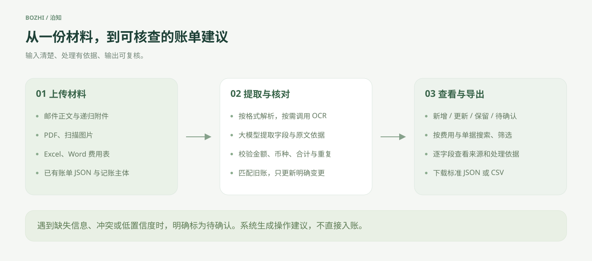
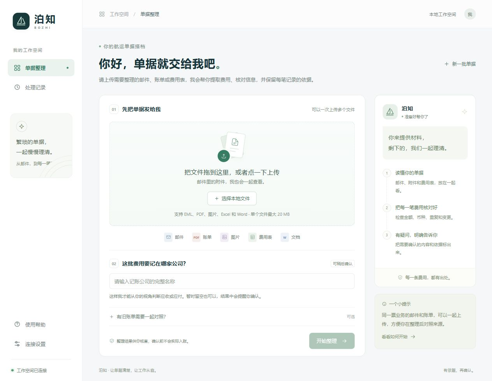
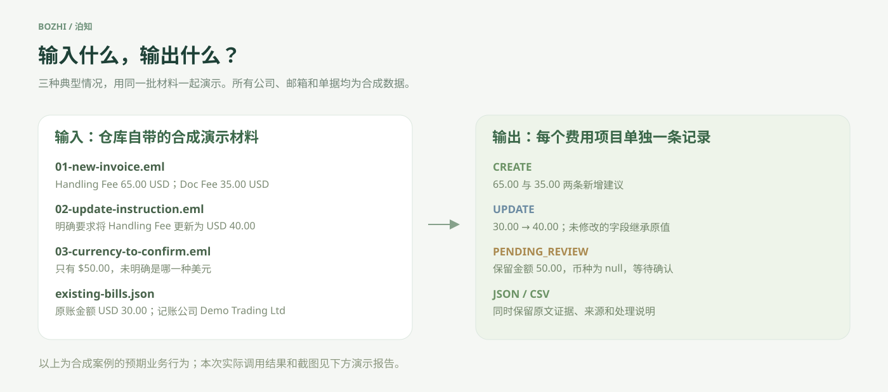
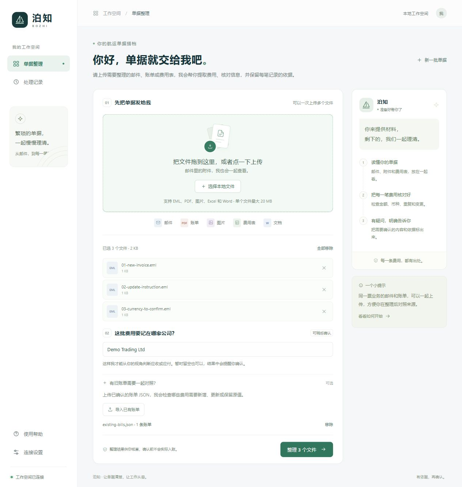
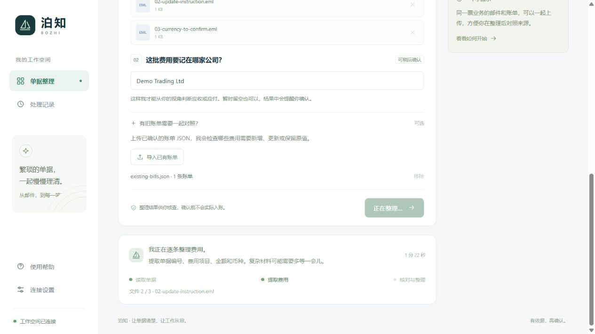
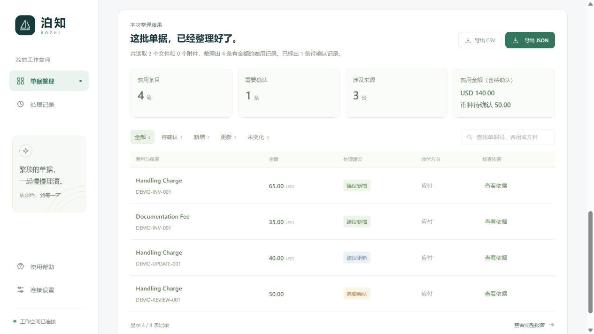
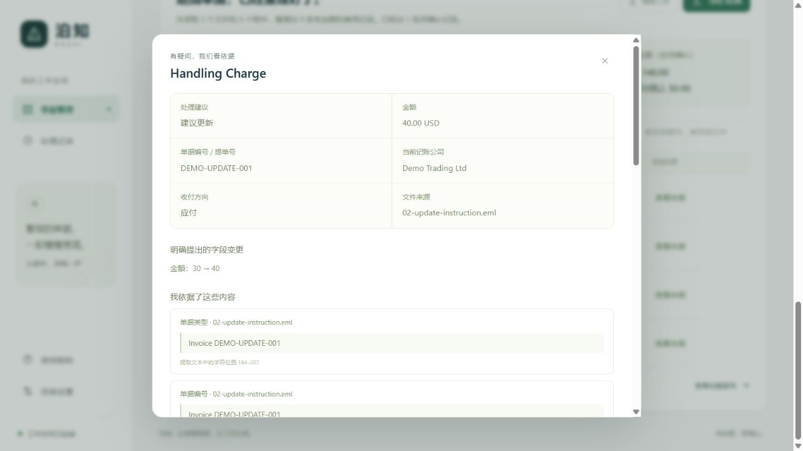
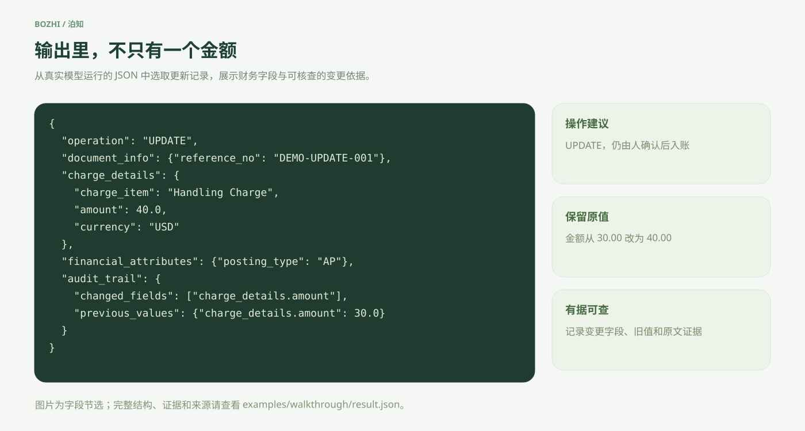

# 泊知 · 你的航运单据搭档

把邮件、账单和费用表，整理成有原文依据的账单建议。

泊知面向航运和国际货代费用整理，使用 **Python、LangChain、智谱 GLM 和确定性校验规则**。它可以提取费用、对照旧账、判断收付方向，将不明确的内容留给人确认，并导出标准 JSON 或 CSV。系统生成操作建议，不直接入账。

**本地网页 · 多格式解析 · 逐字段证据 · 增量更新 · 103 项自动化测试**

维护者 [sansa333](https://github.com/sansa333) · [GitHub 仓库](https://github.com/sansa333/bozhi)

## 先用一张图看懂



| 你提供什么 | 泊知完成什么 | 你得到什么 |
|---|---|---|
| EML 邮件与附件、PDF、图片、Excel、Word | 解析文档、提取单据与费用、核对金额和币种 | 每笔费用一条结构化记录 |
| 当前记账公司、可选的已有账单 JSON | 匹配旧账、检查变更、判断 AR/AP | 新增、更新、保留或待确认建议 |
| 原始文字与明确修改指令 | 验证引文、保留未修改字段、检查冲突 | 来源、逐字段证据、变更前值和待确认原因 |

## 界面是什么样

上传区采用引导式工作台。常用操作直接展示，识别服务由后台统一配置，页面不要求使用者选择识别方式。



## 输入什么，输出什么

仓库自带三份可公开分发的合成邮件、一份合成旧账和一套真实模型运行快照。公司、邮箱、单据编号和费用均为演示数据，不是客户账单。



| 输入文件 | 场景 | 预期业务行为 |
|---|---|---|
| [01-new-invoice.eml](examples/walkthrough/01-new-invoice.eml) | Handling Fee 65 USD、Doc Fee 35 USD | 两条 `CREATE`，费用名标准化 |
| [02-update-instruction.eml](examples/walkthrough/02-update-instruction.eml) | 明确要求将 Handling Fee 改为 40 USD | 匹配旧账后 `UPDATE`，其他字段继承 |
| [03-currency-to-confirm.eml](examples/walkthrough/03-currency-to-confirm.eml) | 只写 `$50.00`，未说明币种 | `PENDING_REVIEW`，币种保留为 `null` |
| [existing-bills.json](examples/walkthrough/existing-bills.json) | 已有 Handling Charge 为 30 USD | 用于对照变更前后金额 |

### 第一步，上传材料，填写记账公司

选择三份 `.eml`，记账公司填 `Demo Trading Ltd`，再展开“有旧账单需要一起对照”，导入上面的 `existing-bills.json`。



### 第二步，开始整理，查看真实处理阶段

页面展示后台实际执行到的阶段和正在处理的文件，不使用模拟百分比。复杂材料或服务限流时可能等待更久。刷新页面会尝试找回同一任务，不会自动重复发起模型调用。



### 第三步，一起核对结果

下图来自本仓库合成材料的实际运行。完整结果保存在 [result.json](examples/walkthrough/result.json)，运行信息、原文和证据保存在 [report.json](examples/walkthrough/report.json)。模型输出有波动，复现时请以本次报告为准，不以截图代替核查。



### 第四步，查看字段变更与原文依据

点击“查看依据”，可以核查当前主体、原始费用、修改了哪些字段，以及引文来自哪里。没有充分证据的字段不会被悄悄补全。



### 第五步，导出你需要的格式

JSON 适合交给财务系统或继续处理，CSV 适合人工核对。导出由后台直接生成，金额使用 Decimal，避免浏览器转换金额时丢失精度。下面图片从本次实际 JSON 输出中选取字段，不是界面设计稿。



完整输出保留 `document_info`、`transaction_party`、`charge_details`、`financial_attributes` 和 `audit_trail`。`audit_trail` 包含来源、证据、待确认原因，以及更新时的 `changed_fields`、`previous_values`。

## 五分钟运行起来

需要 Python 3.12 和 [uv](https://docs.astral.sh/uv/)。以下命令在仓库根目录执行。

```powershell
git clone https://github.com/sansa333/bozhi.git
cd bozhi
uv sync --frozen --extra dev

# 只在没有配置文件时创建，不覆盖已有密钥
if (-not (Test-Path .env)) { Copy-Item .env.example .env }
```

编辑本地 `.env`，填写自己的密钥。下面是配置格式，仓库不包含可用密钥。

```dotenv
LLM_API_KEY=填写你自己的密钥
LLM_BASE_URL=https://open.bigmodel.cn/api/paas/v4/
LLM_MODEL=glm-4.5-flash
OCR_MODE=remote
ACCOUNTING_ENTITY=
```

```powershell
# 小规模真实调用，验证当前配置，而不只是检查“有没有填写密钥”
uv run shipping-agent doctor --live

# 启动本地网页，Windows 也可以运行 .\start.ps1
uv run shipping-agent serve --port 8010
```

打开 [本地工作台](http://127.0.0.1:8010/)。Linux/macOS 也可使用 `uv sync` 和 `uv run shipping-agent serve`，首次配置时自行将 `.env.example` 复制为 `.env`。

### 直接复现本页的三种案例

```powershell
# 无需密钥，重放已经保存的真实抽取快照，不发起新的模型或 OCR 调用
uv run python scripts/run_walkthrough.py --replay

# 使用你自己的 .env，真实调用模型处理同样的输入
uv run python scripts/run_walkthrough.py --live
```

结果默认写入 `output/walkthrough.json` 和 `output/walkthrough.report.json`。重放会明确标记 `extraction_mode=replay`，不能作为一次新的模型可用性或准确率验证。

如只想离线查看基础 CREATE/UPDATE 规则，也可以运行 `uv run python scripts/demo.py`。该命令使用另一组合成快照，不会调用模型。

## 大模型现在能不能调用？

2026-10-30 北京时间 13:50 的小规模检查已成功，请求模型名为 `glm-4.5-flash`，输入 15、输出 4，共 19 个 token。完整的脱敏记录见 [模型检查结果](docs/model-status.json) 和 [核查说明](docs/model-status.md)。这只是当时的可用性记录，不是持续可用承诺。

**调用成功不等于查到了账户余额。** 本项目没有查询你的付费余额、赠送额度有效期或套餐剩余量。初次请求遇到过服务端网络错误，重试后恢复；直接请求新型号时也观察到限流与超时。

智谱官方已说明 GLM-4.7-Flash 替换 GLM-4.5-Flash，旧请求会路由至新型号。当前保留这次已实测成功的兼容模型名；如按官方指引更换 `LLM_MODEL`，请先重新运行 `doctor --live`。[官方公告](https://www.zhipuai.cn/zh/news/148)、[模型文档](https://docs.bigmodel.cn/cn/guide/models/free/glm-4.7-flash)

## PDF 和图片还需要什么？

默认 `remote` 模式使用题目指定的 OCR 接口。该服务需要可下载的公网 HTTPS 地址，不能读取你的本机路径。把授权使用的下载地址配置为“文件 SHA256 → URL”清单，然后在网页“连接设置”中填写，或通过 CLI 的 `--urls` 传入。

```powershell
uv run shipping-agent inspect '<你的材料目录>' --out output/manifest.json
```

EML、Excel、DOCX 可以直接解析；本页的三份合成邮件不依赖远程 OCR。开发时也可在后台将 `OCR_MODE` 改成 `local`，用本地方式预览 PDF 和图片，但结果会保留待确认标记，不能冒充指定 OCR 的验收结果。

指定 OCR 已使用公开测试 PDF 验证能响应。其实际返回可能是结构化业务对象而非原始文字，这种结果会要求对照原件核查。用户原始账单经指定 OCR 的完整识别尚未验收。[详细使用和接口配置](docs/usage.md)

## 决策边界

| 情况 | 行为 |
|---|---|
| 有效费用，没有匹配旧账 | 建议 `CREATE` |
| 唯一匹配旧账，且存在明确修改指令和字段证据 | 建议 `UPDATE`，保留其他字段 |
| 与旧账相同，无需变更 | `NO_CHANGE` |
| 币种缺失、方向不明、证据不足、金额冲突或多重匹配 | `PENDING_REVIEW` |

模型提取候选字段，代码负责证据、财务校验和操作建议。合计引文遗漏时，只有原文中存在唯一、明确、同币种且同金额的 TOTAL 行，才能用规则补充引文，不通过明细求和虚构原始合计。该补充会记录在运行事件中。

同名费用不直接合并；裸 `$` 不直接当作 USD；Debit Note/Credit Note 不单独决定 AR/AP；null 不覆盖已有值。更多设计、harness 和业务思考见 [设计说明](docs/design.md)。

## 仓库结构

```text
shipping-bill-agent/
├── src/shipping_agent/   # 解析、模型抽取、证据校验、账单规则、API 与前端
├── tests/                # 默认离线的回归与接口测试
├── examples/walkthrough/ # 可分发的合成输入、实际输出与抽取快照
├── docs/assets/          # 本 README 的真实界面截图与 SVG 流程图
├── docs/                 # 使用说明、harness 设计、验证范围与模型检查记录
├── scripts/              # 演示、文档检查、材料评测、打包
├── .github/workflows/    # GitHub Actions 检查
├── .env.example          # 不含密钥的配置模板
├── pyproject.toml        # 项目与依赖配置
└── uv.lock               # 锁定依赖
```

`.env`、真实业务材料、`data/private`、运行输出、虚拟环境和生成的 ZIP 不进入 Git。网页访问凭据只保存在当前页面内存中。仓库里的演示图片和输出只使用合成业务数据。

## 验证与交付

```powershell
uv sync --frozen --extra dev
uv run pytest -q
uv run ruff check src tests scripts
node --check src/shipping_agent/web.js
uv run python scripts/check_docs.py
uv run python scripts/package.py
```

交付包生成在 `dist/shipping-bill-agent.zip`。CI 执行离线测试、代码检查、前端语法检查和 README 本地图片/链接检查，不会在 GitHub Actions 中偷偷调用付费服务。

| 文档 | 内容 |
|---|---|
| [部署与详细使用](docs/usage.md) | CLI、OCR、格式支持、API 与 Docker |
| [设计与业务思考](docs/design.md) | harness、证据、会计判断与生产边界 |
| [验证记录](docs/validation.md) | 已通过的检查与尚未完成的外部验收 |
| [模型状态](docs/model-status.md) | 连通性、错误类型与额度能确认到什么程度 |
| [开发说明](CONTRIBUTING.md) | 本地开发和修改检查 |
| [数据与凭据](SECURITY.md) | 密钥、运行数据与问题报告方式 |

当前是可运行的本地单进程工作台。任务状态不跨服务重启续跑，已完成报告可从历史记录恢复；DOC 需要 LibreOffice；Docker 配置已提供但尚未在本机运行验收。生产多租户、并发账本写入、审批和财务系统连接需要另行接入。
